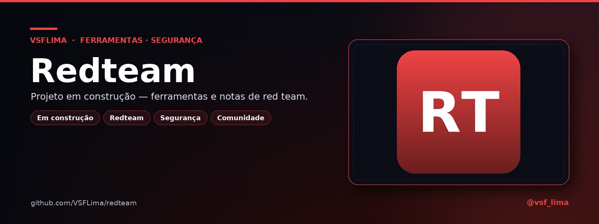

# 🛡️ Redteam

**Projeto em construção — ferramentas e notas de red team.**

Repositório reservado para o projeto **Redteam**. Ainda não há código; o espaço está aberto para contribuições.

---

## 📖 Sobre

Este repositório está reservado para o projeto **Redteam**: ferramentas, notas e experimentos de red team. Ainda não há código — o espaço está aberto para contribuições.

## 🚧 Status

Em construção. Sem código e sem release por enquanto.

## 🤝 Contribuindo

Contribuições são bem-vindas! Leia o [`CONTRIBUTING.md`](CONTRIBUTING.md). O projeto é open source sob a licença MIT.

Para ferramentas de segurança: use apenas em alvos autorizados e **nunca** envie segredos, cookies, tokens ou achados reais em issues/PRs.

## 📄 Licença

Distribuído sob a licença **MIT**. Veja [`LICENSE`](LICENSE).

---

Feito por <a href="https://t.me/vsf_lima">@vsf_lima</a> — VSFLima

